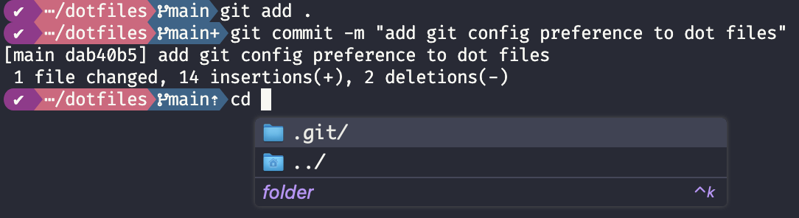

# Personal config for terminal stuff.



## Installs

- double click `Snazzy.itermcolors`
- in `iterm -> settings -> profiles -> colors -> color presets...` select Snazzy
- `iterm -> settings -> profiles -> text -> font` choose FiraCode Nerd Font Mono
- `iterm -> profiles -> keys -> key mappings -> presets -> natural text editing`

Remove home dir configs, and replace them with symlinks to this repo

```shell
rm -f .zprofile .zshrc .bashrc  .profile
ln -s ~/dotfiles/.zprofile ~/.zprofile
ln -s ~/dotfiles/.zshrc ~/.zshrc
ln -s ~/dotfiles/.bashrc ~/.bashrc
ln -s ~/dotfiles/.profile ~/.profile

# Install Homebrew packages
brew install fastfetch fzf starship fnm

# Install Homebrew cask applications
brew install --cask iterm2 kiro-cli font-fira-code-nerd-font rectangle

# setup linking ghostty to kiro
kiro-cli integrations install input-method
# Install the latest LTS version of Node.js using fnm
fnm install --lts
```

- Open Kiro CLI app and configure
  - allow permissions
  - disable all features but CLI completions

### VS code color fix

`>preferences: Open User Settings (JSON)`

```json
{
  "terminal.integrated.minimumContrastRatio": 1
}
```

### Git Config

`~/.gitconfig`

```ini
[user]
	name = Robert Aron
	email = robert.aron.tx@gmail.com
[pull]
	rebase = false
[push]
	autoSetupRemote = true
```

### Ghostty

```shell
mkdir -p ~/.config/ghostty
ln -sfn "$HOME/dotfiles/config.ghostty" "$HOME/.config/ghostty/config"
```

## Extra

`.bashrc` and `.profile` are both used for bash shells, which is not as feature rich as zsh. Basically, don't use them.